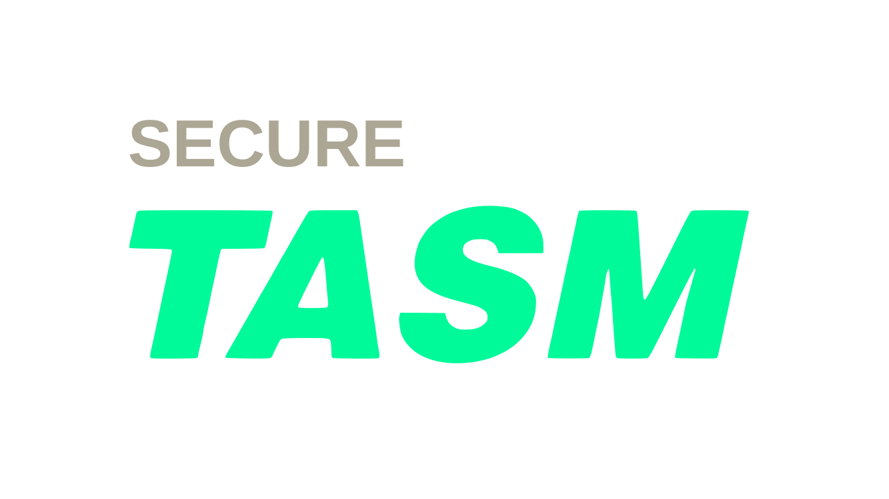
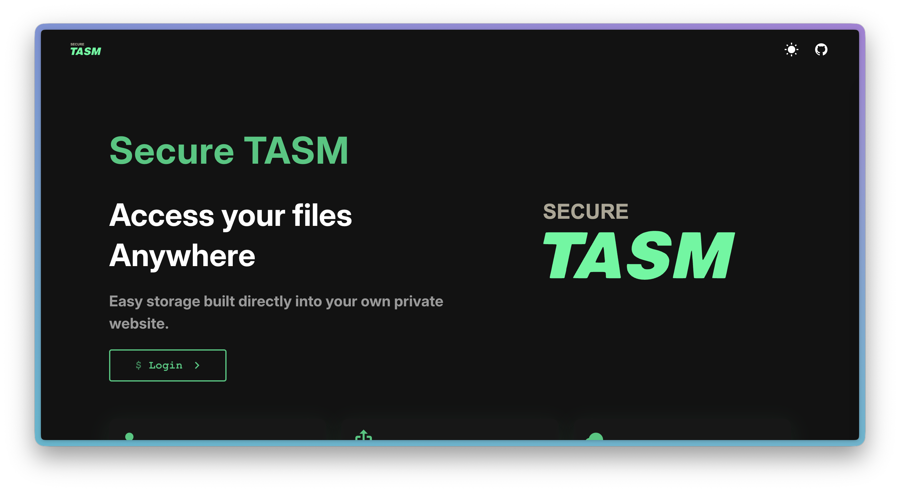

<h1>Secure TASM</h1>

### Repository name: Toritsudaigaku

[Please visit my website here!!!](https://secure-tasm.lozdo.com)

> **"Access your files
> Anywhere"**
> Easy storage built directly into your own private website.

<p style="display: inline">
    <a href="https://www.docker.com/" target="_blank"></a>
    <a href="https://vuejs.org//" target="_blanck"></a>
    <a href="https://www.typescriptlang.org/" target="_blanck"></a>
    <a href="https://www.typescriptlang.org/" target="_blanck"></a>
</p>





## Features

### 1. Secure

Securely stored on our own servers and encrypted media. Please use with confidence. Secure is important.

### 2. Easy to Share

Strictly control file access by precisely specifying authorized individuals for each file, ensuring secure sharing.

### 3. High Availability

Powered by Amazon S3 for exceptional reliability, scalability, and seamless content delivery.

## Getting Started

### Prerequisites

- Docker & Docker Compose

### Installation

1. **Clone the repository**

    ```bash
    git clone git@github.com:youtame/toritsudaigaku.git
    cd toritsudaigaku

    ```

1. build docker container

    ```bash
    docker compose up -d --build
    ```

1. visit your site
   [http://localhost:5173](http://localhost:5173 "http://localhost:5173")

## Library

| Library             | Version | Use if for                    |
| :------------------ | :------ | :---------------------------- |
| Docker              | Latest  | Project execution environment |
| TypeScript          | ~6.0.0  | Site                          |
| Vue.js              | ^3.5.40 | Site                          |
| Vite                | ^8.1.5  | Site                          |
| Vuetify             | ^4.1.7  | Design                        |
| express             | 5.2.1   | Backend                       |
| google-auth-library | 10.6.2  | Google OAuth                  |
| helmet              | 8.2.0   | Backend                       |
| multer              | 2.1.1   | Backend                       |
| pg                  | 8.20.0  | Backend                       |

## Why is the repository named "Toritsudaigaku"?

Do you know Toritsudaigaku Station?

> Toritsu-daigaku Station (都立大学駅, Toritsudaigaku-eki) is a Tōkyū Tōyoko Line station located in Meguro Ward, Tōkyō.
> _— from Wikipedia_

I came up with the idea for Secure TASM when I visited Toritsudaigaku Station.

## Cheat Sheet

It's designed to be self-explanatory. If you need a cheat sheet, TASM isn't finished yet.
